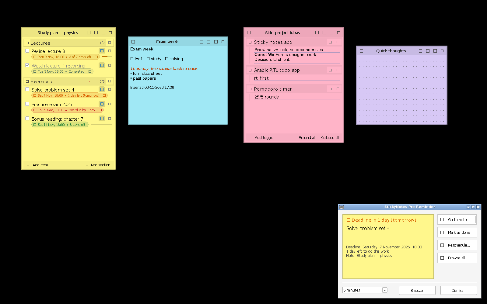
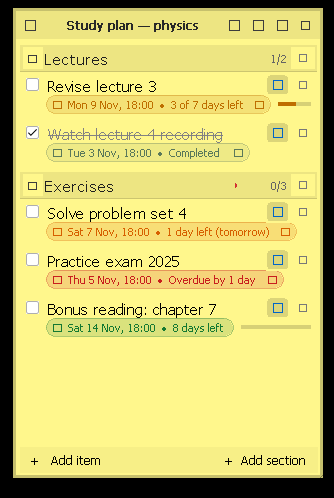
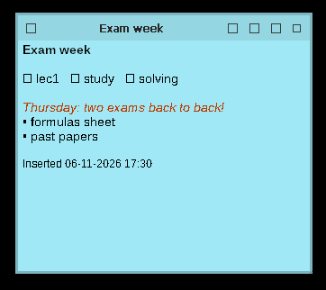
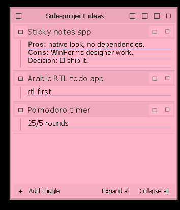
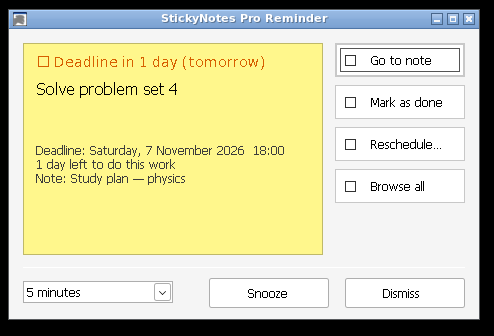
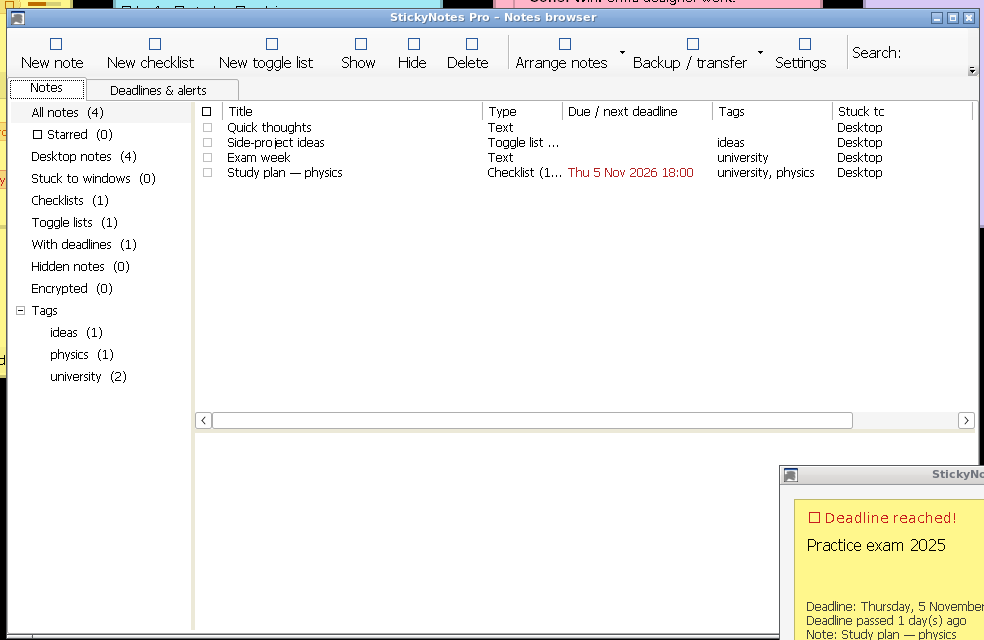
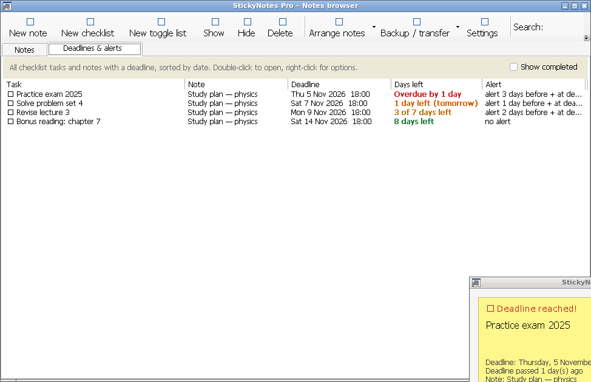
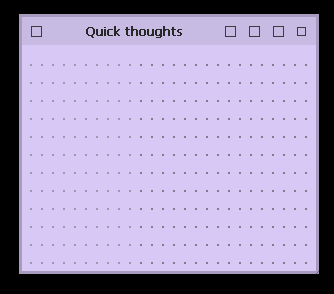
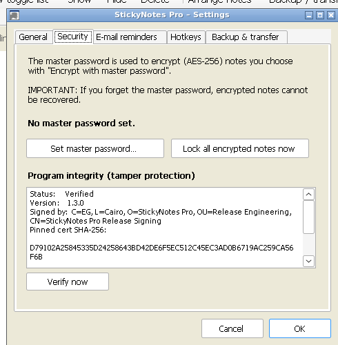

# StickyNotes Pro

A sticky notes app for Windows 10/11, modelled on Notezilla.

> **License:** proprietary — source is published for review/audit only. See [LICENSE](LICENSE). Use of the compiled releases is governed by the Terms & Conditions in [installer/LICENSE.rtf](installer/LICENSE.rtf). Publishing to GitHub? Read [GITHUB.md](GITHUB.md).

---

## Screenshots



| Checklists with a deadline + days-left chip per item | Multiple inline checkboxes on one line | Toggle lists that expand & collapse |
|---|---|---|
|  |  |  |

| Reminder popup (snooze, reschedule, go to note…) | Notes browser with filters & tags | Deadlines & alerts tab |
|---|---|---|
|  |  |  |

| Colors / skins / transparency | Settings → Security: tamper protection |
|---|---|
|  |  |

---

**Run it:** double-click `StickyNotesPro.exe`. You don't need to install anything, because it uses .NET Framework 4.8, which comes with Windows 10 and 11.
The app sits in the **system tray**, the area by the clock. Right-click the yellow note icon there to see all options.

> The app and its installer are **digitally signed** with the release certificate (see *Security & integrity* below). Because the certificate is publisher-issued rather than bought from a public CA, Windows SmartScreen may still warn on first run until the certificate is trusted. Click **More info → Run anyway**.

---

## Features

| Feature | How to use it |
|---|---|
| **Notes on your desktop** | Press `Ctrl+Alt+N` or use tray → New note. Drag the title bar to move a note, drag its edges to resize it, and double-click the title to roll it up. |
| **Checklist notes** | Press `Ctrl+Alt+C`, or use ☰ → Convert to checklist. Press **Enter** to add a new item and tick the box when an item is done. |
| **Checkboxes on the same line** | In a text note or inside a toggle, type `( ) lec1   ( ) study   ( ) solving`. Each `( )` turns into a clickable box as you type, giving **☐ lec1 ☐ study ☐ solving** on one line. You can also **select text and click the ☑ Checkbox button** in the toolbar, or press `Ctrl+Shift+C`. Commas, tabs or 2+ spaces split the selection into separate boxes, and `( )` / `[ ]` markers are converted. With nothing selected, the button inserts a box at the cursor. **Click a box to tick it**, or press `Ctrl+Space` with the cursor next to it. The item is crossed out and greyed. The toolbar shows *2/3 done*. Right-click gives *Tick all / Untick all*. Pressing the button again on a selection removes its boxes. |
| **Checklist sections (collapsible)** | Click **+ Add section** at the bottom of a checklist, or press `Ctrl+Shift+H` on an item to turn it into a section title. Click the ▸/▾ arrow (or press `Ctrl+Enter` on the title) to collapse or expand the items under it. The title shows how many of its items are done, e.g. *2/5*, and a red dot if one of them is overdue. |
| **Toggle list notes** | Press `Ctrl+Alt+T`, use tray → *New toggle list note*, or ☰ → Note type → *Toggle list*. Add as many titles as you like. Each title **expands and collapses** to show its own content, which can use bold, colors, bullets and pictures. Shortcuts: **Enter** in a title jumps to its content, `Ctrl+Enter` expands/collapses, `Ctrl+Shift+Enter` adds a new toggle, `Alt+↑/↓` moves a toggle. ☰ → *Expand all / Collapse all* works on every toggle at once. |
| **Change note type** | ☰ → **Note type**: Text ↔ Checklist ↔ Toggle list. Content is converted for you: toggle titles become checklist sections, and blank-line-separated paragraphs become toggles. |
| **Deadline for each checklist item** | Click the **📅 button** next to an item. Pick a date and time, or use the quick buttons (Today, Tomorrow, +3 days, +1 week…). The item then shows *"Sat 24 Oct, 18:00 • 3 of 5 days left"* with a progress bar. |
| **Alert on/off + 1/2/3 days before** | In the deadline window, tick **"Alert me"**. Then choose a **first alert** time (*1 day, 2 days, 3 days, 4 days, 5 days or 1 week before*) and, if you want, **"also alert when the deadline arrives"**. |
| **Days remaining** | The deadline window shows *"You have N days to finish this work"*, counted from today to the deadline. The note keeps this count up to date. It turns orange when the deadline is close and red when it's overdue. |
| **Reminder popup** | Buttons: Go to note · Mark as done · Reschedule · Browse all · **Snooze** (5 minutes to 1 week) · Dismiss. If the PC was off when an alert was due, it shows the alert when the app next starts. |
| **E-mail reminders** | Set up e-mail in Settings → E-mail reminders (SMTP), then tick "send to my e-mail" on a deadline. |
| **Note for a specific window** | Open a note's ☰ menu → **Stick to window…** (`Ctrl+W`), then pick a window such as *Google Chrome*. The note then appears **on top of that window whenever it's active** and hides when you switch away. Use `*` wildcards, e.g. title `*YouTube*`. |
| **Quick window note** | While using any program, press **`Ctrl+Alt+W`**. A new note is created and attached to that window straight away. |
| **Due date for a whole note** | ☰ → Due date / alert (`Ctrl+R`) |
| **Rich text** | Toolbar at the bottom: bold, italic, underline, strikethrough, bullets, text color, highlight, font, alignment, insert date/time (F5), word count. Also *Paste as plain text* (`Ctrl+Shift+V`) and Find (`Ctrl+F`). |
| **Spell check** | Uses the spell checker built into Windows (red squiggles). Right-click a word for suggestions. |
| **Pictures in notes** | Paste an image, or use the toolbar's picture button / right-click → Add picture. |
| **Colors, skins, transparency** | ☰ → Appearance: 11 colors or a custom color. Skins: ruled, notebook, grid, dotted, antique paper. Transparency: 0–60%. |
| **Tags** | ☰ → Tags. Filter by tag in the Notes browser. |
| **Lock & encrypt** | ☰ → Lock (read-only), or encrypt a note with a master password (AES-256). |
| **Link files & folders** | ☰ → Linked files & folders, or drag files onto a note's title bar. |
| **Always on top / hide / delete / properties** | In the ☰ menu |
| **Notes browser** | `Ctrl+Alt+B`: search, filters, tags, star notes, arrange notes (cascade, tile, line up). The **Deadlines & alerts** tab (`Ctrl+Alt+D`) lists every task that has a deadline. |
| **Send to** | Clipboard, .txt, .rtf, e-mail, print |
| **Backup & transfer** | Tray → **Backup & transfer** (also in the Notes browser and in Settings): **Export all notes…** writes everything to one `.snpbackup` file: notes, checklists, toggle lists, deadlines, tags, positions and settings. On another PC or a newer version, **double-click the file** or use **Import from backup…**. Then choose **Merge**, which adds the notes and keeps the newer copy of any note that exists in both, or **Replace**. You can also export only the notes you selected in the browser, or export all notes as a text file. |
| **Automatic backups** | The app makes one backup per day, plus a safety copy before every import, in `%APPDATA%\StickyNotesPro\backups`. It keeps the last 10. |
| **Start with Windows** | On by default. You can turn it off in Settings. |

## Keyboard shortcuts
Global: `Ctrl+Alt+N` new note · `Ctrl+Alt+C` new checklist · `Ctrl+Alt+T` new toggle list · `Ctrl+Alt+W` note for the active window · `Ctrl+Alt+B` browser · `Ctrl+Alt+D` deadlines · `Ctrl+Alt+H` hide/show all notes

In a note: `Ctrl+Shift+C` checkboxes (same line) · `Ctrl+N` new · `Ctrl+F2` edit title · `Ctrl+R` due date · `Ctrl+W` stick to window · `Ctrl+D` delete · `Alt+Enter` properties

In a checklist: `Enter` new item · `Ctrl+Enter` mark done (on a section: collapse/expand) · `Ctrl+Shift+D` set deadline · `Ctrl+Shift+H` item ↔ section · `Alt+↑/↓` move item

In a toggle list: `Enter` (in a title) go to its content · `Ctrl+Enter` expand/collapse · `Ctrl+Shift+Enter` new toggle · `Ctrl+↑` back to the title · `Alt+↑/↓` move toggle

## Your data
All notes are saved automatically to `%APPDATA%\StickyNotesPro\notes.xml`, with a `.bak` backup next to it. Installing a newer version over an older one keeps your notes. Version 1.1 reads 1.0 data as it is. To move notes to another computer, use **Backup & transfer** (see above). Import also accepts a raw `notes.xml` from any version.

## Security & integrity
StickyNotes Pro protects itself against tampering:

- **Digitally signed on build** – the exe, the installer and the uninstaller are signed with the release code-signing certificate (RSA-3072) and timestamped (RFC 3161).
- **Start-up self-verification** – before any window opens, the app re-computes the Authenticode SHA-256 digest of its own file, verifies the PKCS#7 signature itself (pure managed code – no trust store involved) and requires exactly the pinned release certificate. One changed byte, data appended after the signature, a stripped signature or a foreign certificate all stop the app immediately.
- **Installed-copy hash check** – Setup writes the exe's SHA-256 to the registry (HKLM, administrator-only); installed copies must match it exactly.
- **Continuous runtime checks** – every 15 seconds, and immediately when the exe file changes on disk: signature, hash, a byte-for-byte compare of the loaded code, plus a scan of loaded modules (unsigned modules from user-writable folders = injection → instant termination). A debugger check runs every 1.5 s.
- **Fail closed & logged** – any violation is written to `%APPDATA%\\StickyNotesPro\\security.log` and the process ends at once.
- **Strict input validation** – XML is parsed without DTDs/external entities and with size limits; pasted/loaded RTF is sanitised (embedded OLE objects, packages and `\\objdata` payloads are removed); only http/https/mailto links open; file links and launched programs need confirmation; wildcard patterns are length-limited with regex timeouts; e-mail headers are stripped of CR/LF; every data field is bounded and whitelisted.
- **See for yourself** – Settings → **Program integrity** shows the live status (signer, SHA-256, last check) with a **Verify now** button.

## Verify a copy you're given
The signed release lives in `release/1.3.0/` and contains:
- `StickyNotesPro_1.3.0_Certificate_of_Integrity.pdf` – the formal release record (version, exe SHA-256, certificate details, tamper-test results), itself digitally signed. **Any copy whose SHA-256 differs from this record is not genuine – do not run it.**
- `Verify-StickyNotesPro.ps1` – run it in PowerShell next to the exe to check hash + signature + certificate automatically.
- `SHA256SUMS.txt`, the release certificate `.cer` and a machine-readable `release-manifest.json`.

## Building from source
The `src` folder has the full C# source code (WinForms, .NET Framework 4.8). To build it:
```
dotnet build src -c Release
```

### Signed release build (v1.3+)
`build/release.sh` runs the whole pipeline: compile (warnings as errors), generate or reuse the code-signing certificate, **pin the certificate's SHA-256 into the exe** (`src/Security/SigningPin.g.cs`), sign + timestamp the exe, verify it with `osslsigncode` and the standalone IntegrityVerifier (the same code the app runs at start-up), run four tamper tests (patched byte, appended data, unsigned, foreign certificate – all must be rejected), build + sign the NSIS installer and uninstaller, and produce the signed PDF certificate of integrity + manifest + `SHA256SUMS.txt` in `release/<version>/`.

Environment variables:
| Variable | Meaning |
|---|---|
| `SNP_PFX` | Path to a **real CA-issued (OV/EV) code-signing PFX**. If unset, a self-signed release certificate is generated into `signing/` (never ship that folder). |
| `SNP_PFX_PASS_FILE` | File containing the PFX password. |
| `SNP_TSA` | RFC 3161 timestamp server (default `http://timestamp.digicert.com`). |
| `SNP_PYTHON` | Python used for the PDF record (needs `pyhanko`, `reportlab`, `cryptography`). |

> **Important:** the exe refuses to start unless it is signed with the pinned certificate. After any change, rebuild through `build/release.sh` (not plain `dotnet build`) or the app will reject itself.

## Installer (Setup)
`StickyNotesPro_Setup_1.3.0.exe` is the installer. It also registers `.snpbackup` files so you can double-click a backup to import it. It runs these steps in order:
1. **Welcome**
2. **Terms and Conditions**. **Next** stays disabled until you select *"I accept the terms of the License Agreement"*. If you don't accept, Setup can't continue.
3. **Components**: the program (required), a desktop shortcut, and start with Windows.
4. **Install location**: `C:\Program Files\StickyNotes Pro` by default.
5. **Finish**, with an option to start the app straight away.

Setup also:
- Signs the uninstaller too, and records the exe's SHA-256 in HKLM so the app can verify the installed copy.
- Adds Start Menu shortcuts: the app, Terms and Conditions, the quick start guide, and Uninstall.
- Adds an entry in *Settings → Apps* so you can uninstall from there.
- Checks that .NET Framework 4.8 is installed.

The uninstaller closes the app and removes it. It then asks whether to keep your notes.

To change the terms, edit `installer/LICENSE.rtf`; rebuild the installer via `build/release.sh` (or `makensis -DEXE_SHA256=<sha256 of StickyNotesPro.exe> installer/setup.nsi`).
